<!-- ═══════════════════════════  HEADER  ═══════════════════════════ -->
<p align="center">
  
</p>

<p align="center">
  <a href="https://github.com/14-David-06">
    
  </a>
</p>

<p align="center">
  
  
  
</p>

<p align="center">
  
</p>

<!-- ═══════════════════════════  ABOUT  ═══════════════════════════ -->
## 🧑‍💻 Sobre mí · About me

- 🌱 Lidero la tecnología de **Sirius Regenerative Solutions**: bioinsumos y biochar para una agricultura regenerativa.
- ⚡ Desarrollo apps web en producción con **Next.js + TypeScript** para laboratorio, pirólisis, finanzas, CRM y SG-SST.
- 🤖 Construyo **agentes de IA** y automatizaciones que trabajan sobre los datos reales de la operación.
- 🛰️ Llevo la tecnología al campo: conteo de ganado con **drones**, apps móviles **sin WiFi** sobre redes mesh e informes de campo **por voz**.
- 🌴 Desarrollo sistemas para la agroindustria de palma de aceite en los Llanos Orientales.

```typescript
const david = {
  role: ["Development Engineer", "Head of Technology @ Sirius Regenerative Solutions"],
  location: "Colombia 🇨🇴",
  code: ["TypeScript", "JavaScript", "Python", "Dart"],
  stack: {
    web: ["Next.js", "React", "Node.js"],
    data: ["Airtable", "Supabase", "AWS S3"],
    mobile: ["Flutter", "Android"],
    ai: ["LLM agents", "Multi-agent systems", "n8n"],
    field: ["Drone imagery", "Google Earth Engine", "Meshtastic mesh", "Raspberry Pi"],
    ship: ["Vercel", "GitHub", "Docker"],
  },
  currentFocus: "AI agents that run real field & business operations",
  mission: "Tech that regenerates the land 🌱",
};
```

<!-- ═══════════════════════════  STACK  ═══════════════════════════ -->
## 🛠️ Tech Stack

<p align="center">
  <b>Frontend & Web</b><br/>
  
</p>
<p align="center">
  <b>Backend & Data</b><br/>
  
</p>
<p align="center">
  <b>Mobile, IoT & DevOps</b><br/>
  
</p>
<p align="center">
  
  
  
  
  
  
</p>

<!-- ═══════════════════════════  HARD SKILLS  ═══════════════════════════ -->
## 🧠 Hard Skills

| Área · Area | Lo que hago · What I do |
|---|---|
| 🏗️ **Full-Stack** | Apps Next.js/React con TypeScript, APIs en Node.js y despliegue continuo en Vercel |
| 🗄️ **Datos · Data** | Modelado en Airtable y Supabase (PostgreSQL), migraciones desde Excel y sincronización entre bases |
| 🤖 **IA aplicada · Applied AI** | Agentes conversacionales y sistemas multi-agente integrados a procesos de negocio |
| ⚙️ **Automatización** | Flujos con n8n e integraciones entre Airtable, APIs y apps internas |
| 📱 **Mobile** | Apps Flutter/Android para trabajo de campo, publicadas en Google Play |
| 📡 **IoT** | Redes mesh Meshtastic, BLE y gateways en Raspberry Pi para zonas sin conectividad |
| 🛰️ **Geoespacial · Geo** | Imágenes de dron, conteo automatizado y Google Earth Engine |
| ✅ **Calidad · Quality** | Vitest, ESLint, tipado estricto con `tsc` y normativa colombiana (SG-SST) |

<!-- ═══════════════════════════  PROJECTS  ═══════════════════════════ -->
## 🚀 Proyectos destacados · Featured projects

<table>
  <tr>
    <td width="50%" valign="top">
      <h3>🐄 <a href="https://github.com/14-David-06/HatoScan">HatoScan</a></h3>
      Conteo de ganado desde imágenes de dron, verificado y listo para el inventario.<br/>
      <sub><i>Drone-based cattle counting, verified and inventory-ready.</i></sub><br/><br/>
      
      
      
    </td>
    <td width="50%" valign="top">
      <h3>🤖 <a href="https://github.com/14-David-06/JARVIS-DEV">JARVIS-DEV</a></h3>
      Sistema multi-agente de inteligencia artificial especializado en desarrollo de software.<br/>
      <sub><i>Multi-agent AI system specialized in software development.</i></sub><br/><br/>
      
      
    </td>
  </tr>
  <tr>
    <td width="50%" valign="top">
      <h3>🎙️ <a href="https://github.com/14-David-06/sirius_agro">Sirius Agro</a></h3>
      Informes de campo por voz: respondes un cuestionario hablando y recibes el informe redactado.<br/>
      <sub><i>Voice-driven field reports: answer out loud, get the written report.</i></sub><br/><br/>
      
      
    </td>
    <td width="50%" valign="top">
      <h3>📡 <a href="https://github.com/14-David-06/GeoMaps">Sirius GeoMaps</a></h3>
      Ubica a las personas dentro de plantaciones y cultivos sin WiFi. Disponible en Google Play.<br/>
      <sub><i>Locate people across plantations with no WiFi. Live on Google Play.</i></sub><br/><br/>
      
      
    </td>
  </tr>
  <tr>
    <td width="50%" valign="top">
      <h3>📊 <a href="https://github.com/14-David-06/sirius_crm">Sirius CRM</a></h3>
      Capa comercial del ecosistema Sirius: pipeline, visitas y casos sobre Airtable, con migración desde Excel y servicio de sincronización.<br/>
      <sub><i>Sales layer for the Sirius ecosystem: pipeline, visits and cases on Airtable.</i></sub><br/><br/>
      
      
    </td>
    <td width="50%" valign="top">
      <h3>🦺 <a href="https://github.com/14-David-06/sirius-sg-sst">Sirius SG-SST</a></h3>
      Sistema de gestión de seguridad y salud en el trabajo bajo normativa colombiana.<br/>
      <sub><i>Occupational health &amp; safety management system (Colombian SG-SST).</i></sub><br/><br/>
      
    </td>
  </tr>
</table>

<p align="center">
  <sub>
    🧪 <b>Ecosistema Sirius:</b>
    <a href="https://github.com/14-David-06/sirius_laboratorio">laboratorio</a> ·
    <a href="https://github.com/14-David-06/sirius_pirolisis">pirólisis</a> ·
    <a href="https://github.com/14-David-06/sirius_financiero">financiero</a> ·
    <a href="https://github.com/14-David-06/sirius_clientes">pedidos de clientes</a> ·
    <a href="https://github.com/14-David-06/sirius_agent">agente IA</a>
    &nbsp;|&nbsp;
    🌴 <b>Agroindustria:</b>
    <a href="https://github.com/14-David-06/guaicaramo-inducciones">inducciones</a> ·
    <a href="https://github.com/14-David-06/guaicaramo_biogas">biogás</a> ·
    <a href="https://github.com/14-David-06/guaicaramo_bascula">báscula</a> ·
    <a href="https://github.com/14-David-06/guaicaramo-visitantes">visitantes</a>
  </sub>
</p>

<!-- ═══════════════════════════  STATS  ═══════════════════════════ -->
## 📈 GitHub Stats

<p align="center">
  
</p>
<p align="center">
  
  
</p>
<p align="center">
  
</p>

<!-- ═══════════════════════════  SNAKE  ═══════════════════════════ -->
<p align="center">
  <picture>
    <source media="(prefers-color-scheme: dark)" srcset="https://raw.githubusercontent.com/14-David-06/14-David-06/output/github-snake-dark.svg" />
    <source media="(prefers-color-scheme: light)" srcset="https://raw.githubusercontent.com/14-David-06/14-David-06/output/github-snake.svg" />
    
  </picture>
</p>

<!-- ═══════════════════════════  FOOTER  ═══════════════════════════ -->
<p align="center">
  
</p>

<p align="center">
  
</p>
